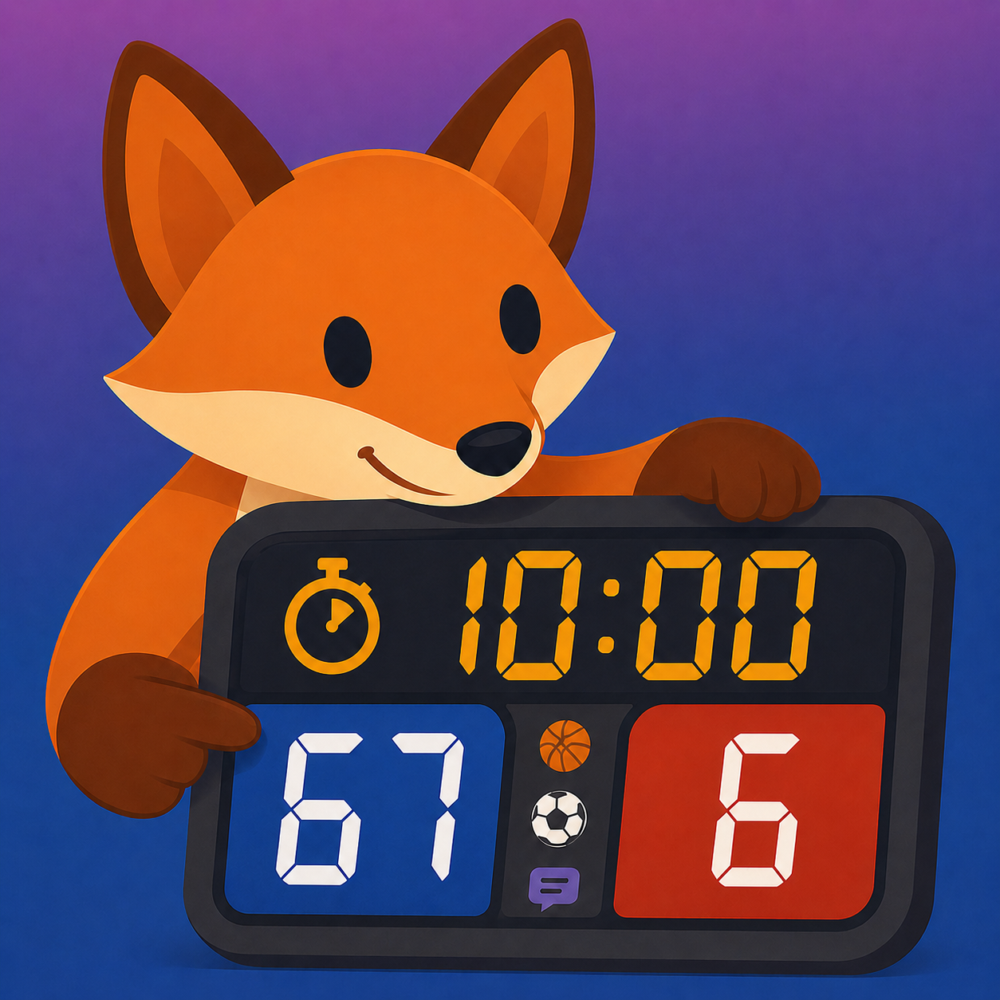

# Scoreboard

<p align="center">
  
</p>

Scoreboard is a SwiftUI scoreboard app for iPhone, iPad, Mac, and Apple TV. iPhone, iPad, and Mac include the operator controls; Apple TV can display a paired scoreboard and run the game as the session host.

This project use AI generated contents.

> App Store: [Link](https://apps.apple.com/us/app/smart-scoreboard/id6776096875)

## Description

Scoreboard turns your iPhone, iPad, or Mac into a flexible, easy-to-control scoreboard for games, practices, tournaments, and debate rounds.

Track scores, clocks, periods, shot clocks, possession, fouls, cards, substitutions, rosters, soccer injury time, chess clocks, hockey penalty timers, and debate prep time from one clean control board. Show a full-screen public scoreboard on an external display, through AirPlay, or on one or more paired Remote Display devices while keeping the controls private on the operator device.

Choose **Local Display → Full Screen** for a presentation display, or **Merged View (Beta)** to operate the game and watch the scoreboard in the same window. The combined view keeps the scoreboard above compact, scrollable controls in both orientations, adapting the control columns to iPhone, iPad, and Mac window sizes.

Built-in presets include Simple, Basketball, Volleyball, Soccer, Hockey, Chess, Debate, and Custom Sport modes. Debate supports Public Forum, Lincoln-Douglas, Policy, and custom round formats.

Apple TV can be used in two ways. You can AirPlay from the operator device to Apple TV without installing the Apple TV app, because AirPlay is treated like an external display. Or you can install Scoreboard on Apple TV and use it as a Remote Display. Apple TV can also be assigned as the session host to run game logic, timers, Web API, and Companion. The operator board, game setup, and files stay on iPhone, iPad, or Mac.

Whether you are running a gym scoreboard, timing a debate round, managing a scrimmage, or keeping a clean public display for spectators, Scoreboard keeps the game organized and visible.

## Full Experience

For the full Scoreboard experience, connect an external display, use AirPlay, or pair Remote Display devices. AirPlay works with Apple TV without installing the app on Apple TV. Remote Display is useful when you want nearby Apple devices, including multiple displays, to receive synced scoreboard updates from the same session host.

## Features

- Real-time score, period, and game clock controls
- Per-sport control board modes for dedicated timer, shot/serve, roster, scoring, and penalty stations, plus customizable modules and team selection
- Soccer and Custom countdown injury-time controls with public +N minute display
- Public scoreboard support for external displays and AirPlay, including Apple TV AirPlay without installing the tvOS app
- Apple TV, iPhone, iPad, and Mac Remote Display pairing with live scoreboard sync across multiple displays
- Built-in modes for Simple, Basketball, Volleyball, Soccer, Hockey, Chess, and Debate
- Custom sport mode with configurable periods, clocks, score steps, possession, players, fouls, cards, and substitutions
- Timed or indefinite team and official pauses, with inline operator controls and synchronized public display overlays
- Shot clock controls for supported sports
- Chess clock presets for bullet, blitz, rapid, and classical play
- Debate timers for Public Forum, Lincoln-Douglas, Policy, and custom formats
- Hockey penalty timers
- Player roster and active lineup tracking
- Team fouls, player fouls, cards, substitutions, and possession tracking where supported
- Theme options for different lighting and presentation needs
- Configurable event sounds for clocks, alerts, fouls, cards, substitutions, and score changes
- Configurable hardware keyboard shortcuts for live control board actions on iPhone, iPad, and Mac
- Save, import, export, and autosave game files
- Event logs with export support
- Local Web API demos, including a commentator dashboard with live match data, current-session timeline, roster alerts, and deterministic talking points
- Paired iPhone, iPad, and Mac remote control boards, with timer delay compensation and simultaneous remote display output
- Assign a paired device, including Apple TV, to host the game while the owner keeps game files and settings
- Optional authenticated Web API control with a resettable 16-character key, control demo, and operation reference

Team pauses are available in Basketball, Volleyball, Hockey, and Custom Sport with the Pauses module enabled. Set **Default Pause Duration**, **Indefinite Team Pauses**, and each team's allowance in **Settings → Pauses**. **Start Pause** always uses the saved countdown duration; enabling indefinite team pauses adds a separate **Start Inf Pause** button. Both starts consume one allowance. Volleyball starts with a 30-second duration; other modes start with 60 seconds. **Official Pause** offers timed and indefinite options in every mode. Active team timer controls replace the start/count row, keeping the panel height unchanged. **Back** opens the pause count controls, and **Return to Timer** reopens the active timer. **Pause +** and **Pause −** only adjust usage counts. Timer controls offer pause/continue and **Stop**; official controls use **Stop Pause**. Starting a pause stops all play timers. At zero, the overlay remains until stopped; stopping leaves play stopped and keeps the team's used allowance.

Pause state follows local, AirPlay, and paired displays, remote control boards, Merged View, Live Activities, saved games, backups, and the Web API's scoreboard, OBS, commentator, and control demos. Opening a saved game or restoring a backup keeps the pause state with its countdown stopped. Keyboard actions include official pause, pause/continue countdown, and **Stop Pause**; start-home/start-guest shortcuts use the saved countdown duration, while Pause +/− shortcuts only adjust counts. Indefinite pauses show centered pause text with the corresponding team logo, falling back to the event logo; official pauses use the event logo. No clock value is shown for indefinite pauses. Sounds and Companion support pause start, official start, countdown pause/resume, end, and expiry events. Stopping either a timed or indefinite team/official pause triggers the configured **Pause Ended** sound and Companion action once. Indefinite pauses never fire the expiry event. API actions are `pause.start`, `pause.official` (both accept value 0 for indefinite), `pause.running`, and `pause.cancel` (the Stop Pause action); read `clocks.pauseTimer`, `clocks.pauseTitle`, `clocks.pauseDurationSeconds`, and `clocks.isTeamPauseIndefinite`. `pause.adjust` remains a usage-count correction.

Open **Control Board Mode** beside the **Theme** menu in the toolbar to choose a station. Presets follow each sport's enabled features: shot/serve timing, roster management, scoring, penalties, or match timing. **Custom Station** lets you select modules, arrange them within the team and timer columns, and choose either team or both. Existing team, player, and timer controls are reused; wide boards keep team columns around the center clock/score box, and narrower panes retain two team columns when space allows. The roster station edits names, numbers, active lineups, fouls, and cards; enable player tracking in Settings first.

Every mode offers **Show Clock & Score Box**, enabled by default, and **Merged View (Beta)**. The summary is read-only in station modes and uses a compact layout in Merged View; hiding it leaves the public scoreboard visible. **Display Control** remains a separate toolbar action. Each device saves its station layout and summary choice for each sport. Switching layouts keeps scores and running timers intact, keyboard shortcuts follow the selected controls, and remote control authorization still applies. The hockey penalty player picker shares the mode picker's themed, scrollable sheet and fixed action bar.

## Supported Platforms

- iPhone
- iPad
- Mac
- Apple TV (Remote Display and session host)

The iPhone, iPad, and Mac app includes the operator interface and can also be switched into Remote Display mode from Settings. Apple TV AirPlay does not require the Scoreboard Apple TV app. If the Apple TV app is installed, it shows the scoreboard and can be selected as the session host. It has no operator control board. Remote Display uses Network Framework Bonjour pairing, not the Web API, and can sync more than one display device from the same session host. The owner can choose same Wi-Fi/LAN only or allow Apple peer-to-peer Wi-Fi for nearby devices.

Remote devices now negotiate an optional data-only WebRTC connection for live state and control, with WebSocket fallback. The Web API control demo also supports RTC with HTTP fallback. The standalone LiveKitWebRTC package includes Apple TV device and arm64 simulator binaries, so Apple TV can host RTC sessions without a LiveKit server. V2 browser resource feeds, pairing, clock synchronization, handoff, images, and logs retain their existing transports. See [WebRTC transport and manual verification](docs/webrtc-transport.md).

## Build From Source

1. Clone the repository.
2. Open `smartScoreboard/smartScoreboard.xcodeproj` in Xcode.
3. Select the `smartScoreboard` scheme.
4. Choose an iPhone simulator, iPad simulator, connected iPhone or iPad, Mac, or Apple TV simulator as the run destination.
5. Build and run.

For iPhone Duo, build with Xcode 27.1 or later to enable the full display area and native vertical toolbars. The live board and Merged View place their header actions along the system-provided edge, including in Split View, and keep the game controls inside the available safe area. Settings also places its return action and section menu in the side bar, freeing vertical space in narrow windows; settings rows adapt to the horizontal size class. Other layouts retain the existing header, with wrapping buttons for narrow windows. Older SDKs and supported OS versions retain the existing navigation. See Apple's [iPhone Duo design guidance](https://developer.apple.com/design/human-interface-guidelines/designing-for-iphone-duo).

## Localization Notes

- Dynamic string wrappers use `ScoreboardLocalization` to read an immutable cache of the compiled `Localizable.strings` table, with the app's preferred language, development-language fallback, and the original key for missing entries. Keep runtime names and already-formatted messages as verbatim text.
- This lookup supports the catalog's current flat `stringUnit` entries. Plural or device variations require extending the resolver before adding them; the catalog check rejects unsupported entries.
- Use the local wrapper functions (`localizedAppText`, `localizedAppFormat`, and the matching store/display wrappers) instead of raw `Text(LocalizedStringKey(...))` or direct localized `String(format:)` calls.
- Treat runtime strings, user-entered names, generated titles, and already-formatted strings as resolved text. Localize them first, then render with `Text(verbatim:)` so SwiftUI does not reinterpret them as localization keys during view rendering.
- Keep `Localizable.xcstrings` format placeholders type-compatible across languages. `%1$@` positional placeholders are fine, but the argument count and placeholder type must still match the source string.
- The top-level `version` field in `Localizable.xcstrings` is the string-catalog schema version, not the app release version.

Localization catalog validation, formatter regressions, and English/Chinese bundle lookup checks run in `LocalizationTests.swift` through **Product → Test** (⌘U). Also check Debate and Custom Sport settings in English and Simplified Chinese on a simulator when changing settings or localization code.

## Project Structure

- `smartScoreboard/smartScoreboard/ContentView.swift` - main operator interface and setup flow
- `smartScoreboard/smartScoreboard/ScoreboardKeyboardShortcuts.swift` - keyboard shortcut catalog, settings UI, and platform key handling
- `smartScoreboard/smartScoreboard/ExternalScoreboardView.swift` - public scoreboard display
- `smartScoreboard/smartScoreboard/ScoreboardStore.swift` - app state and scoring logic
- `smartScoreboard/smartScoreboard/SportType.swift` - sport presets and rule capabilities
- `smartScoreboard/smartScoreboard/DebateModels.swift` - debate formats and timing segments
- `smartScoreboard/smartScoreboard/ScoreboardGameDocument.swift` - saved game file format
- `smartScoreboard/smartScoreboard/ScoreboardLogging.swift` - event log storage and export
- `smartScoreboard/smartScoreboard/BuzzerPlayer.swift` - generated event sounds
- `smartScoreboard/smartScoreboard/ScoreboardTheme.swift` - app and scoreboard themes

## File Types

Scoreboard uses custom JSON-backed document types:

- `.scoreboardgame` for saved game states
- `.scoreboardlog` for exported log sessions

## License

This project is licensed under the GNU General Public License v3.0. See [LICENSE.md](LICENSE.md) for details.

### Remote control

Pair another iPhone, iPad, or Mac using the existing Remote Display workflow. On the main board, open **Settings → Integration → Remote Display** and enable **Allow This Device to Control** in that specific paired device’s row. Permissions are independent for each device. An approved device automatically opens the regular app control board, including player controls, Display Control, Merged View, and Local Display. Its external screen can continue showing the scoreboard. Apple TV supports display and hosting, with controls on iPhone, iPad, or Mac. Timer commands use a simple heartbeat round-trip clock estimate and compensate for travel time; stale or conflicting commands are rejected. Sounds are relayed to paired devices, while Companion commands execute only on the session host.

The device that starts pairing remains the **owner**. To move game logic to another device, open **Settings → Integration → Remote Display & Control** and choose **Make Session Host** for a connected device. There is one host at a time; connected devices move to the selected host after the transfer handshake. An Ethernet-connected Apple TV or Mac can keep timers and other controllers operating while the owner is disconnected. Use **Host on This Device** to move hosting back. Host changes require the current host to be reachable.

Stop every game, shot, debate prep, pause countdown, and penalty timer before moving the host. The connection dropdown lists clients and their links to the current host. The host is excluded from client counts; an owner running on another device is included as **Owner · Client**, with its connection status and available latency/transport details. An offline control board labels the other clients' status as the last report from the host.

A delegated host keeps an isolated match file and log while the owner is offline. When the owner reconnects, the host sends the latest match and log back to the owner's saved game file. **Safe to Disconnect** appears on the owner's control board and connected remote display only after all timers stop and the owner confirms a durable save. Leaving hosted Remote Display mode in that state moves hosting back to the owner and removes the host's isolated copy. If the match is not synced, the exit prompt offers a deliberate choice to keep hosting and reconnect or delete the local match. Use **Open Guide** in Remote Display & Control settings for a court diagram and LAN/nearby pairing explanation.

After a successful handoff, the former delegated host deletes its isolated match, log, recovery record, and retained host checkpoint, using the same data cleanup as discarding a hosted match. It keeps its pairing so it can reconnect as an ordinary remote display or control board. Ordinary remote clients keep active session identity in memory; the owner retains the saved game and recovery copy.

If the host is permanently unavailable, the owner can use **Recover Here** after its connection drops. Recovery uses the owner's last saved host checkpoint, stops all timers, and may lose changes made on the host since that checkpoint. If the old host returns, discard its local hosted match before reconnecting it. A delegated host can choose **Discard Match & Stop Hosting** locally to delete its isolated match and log and return to pairing mode. The remote device's pairing screen does not show the owner setup guide.

On Apple TV, the host's working copy uses tvOS cache storage, which the system can remove after Scoreboard closes. Keep Scoreboard running while the owner is offline, then reconnect the owner and wait for **Safe to Disconnect** before leaving the Apple TV app.

Game files, setup, and integration settings remain on the owner. The host records game events and sends log updates to clients when available, with control and timer traffic taking priority. Web API and Companion run on the host; their settings pages show the host name and IP. Use the host's URL for web integrations. API responses expose session identity through `control.session` in v1, `/api/v2/state/session`, and status endpoints.

For browser or script control, enable the Web API and **Web Control**, then copy the API key. Use `POST /api/v2/control` with `X-API-Key` and a JSON command containing a unique UUID `id`, an `action`, and the current `sport`. The key has 16 letters/digits, is case-insensitive, and can be reset to revoke access. Setup operations are excluded. Open `/demo/control` for the browser controller or `/` for API documentation; `/api/v2/control/operations` lists every shared command and its parameters. Use a trusted local network because HTTP does not encrypt the key.

### Build and test with Xcode

Open `smartScoreboard/smartScoreboard.xcodeproj` in Xcode. To run the app, select **smartScoreboard** and choose **Product → Build** (⌘B).

To run unit tests, select **smartScoreboardTests → My Mac** and choose **Product → Test** (⌘U). The main **smartScoreboard** scheme also runs the unit target on My Mac. The **Run** button (▶ / ⌘R) launches the app in either scheme. The Test navigator (⌘6) shows named Swift Testing cases and individual sport/input cases.

The unit suite covers scoring, roster CSV, all sport capability gates, control board profiles and shortcut filtering, host-centric connection lists, pause timers, remote commands and clock compensation, session authority, recovery, and log replication. Tests use isolated temporary storage and preferences. See [Testing Smart Scoreboard](docs/testing.md) for the terminal command, coverage map, and guidance for adding regression tests.

For simulator UI checks, select **smartScoreboardUITests → an iPad simulator** and press **⌘U**. The default `AllUI` plan enables all cases; choose **Product → Test Plan → SmokeUI** for two control/display cases. UI tests cover event setup and scoring, station presets and customization, running-clock settings, official pauses, full-screen display, scrolling and rotation, Companion failures/recovery, and remote-client pairing/reconnection. See [UI tests and regression history](docs/ui-testing.md).

Shared test plans separate core regressions, operator workflows, and integration recovery for local runs and Xcode Cloud. See [Xcode Cloud test setup](docs/xcode-cloud-testing.md).

Settings-navigation, live HTTP authentication, and localization checks are included in the same Xcode test target. HTTP tests use OS-assigned ports and isolated storage.

Browser DOM tests live in `tests/web` and run with:

```sh
npm ci --prefix tests/web
npm test --prefix tests/web
```
